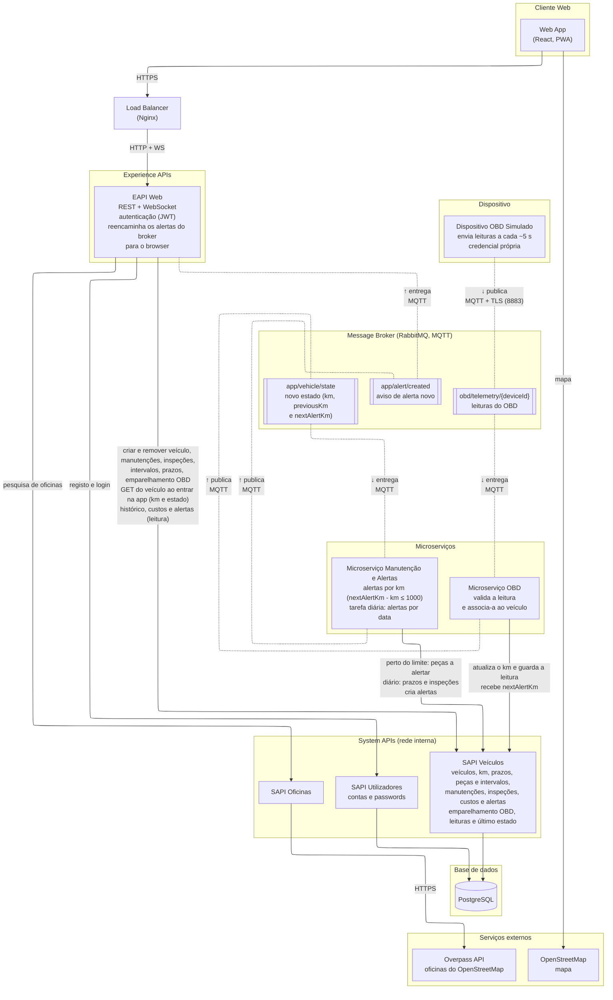

# Arquitetura (v17)

CarMotoCare — Diagrama de arquitetura v17 (22 nov. 2026)
Muda em relação à v16:
- A SAPI Veículos devolve nextAlertKm na resposta de PUT /mileage (menor nextKm das peças sem alerta aberto).
- O Microserviço OBD põe esse valor no tópico app/vehicle/state.
- O Microserviço Manutenção e Alertas só consulta a SAPI quando nextAlertKm - km <= 1000, e tem uma tarefa diária
  para os alertas por data (IUC, seguro, inspeção, peças com intervalo em meses) e verificação de segurança das peças.
- Sem cache e sem componentes novos; mudam só rótulos.

Payload de app/vehicle/state: { vehicleId, userId, km, previousKm, nextAlertKm, readAt } (ver contrato MQTT)

