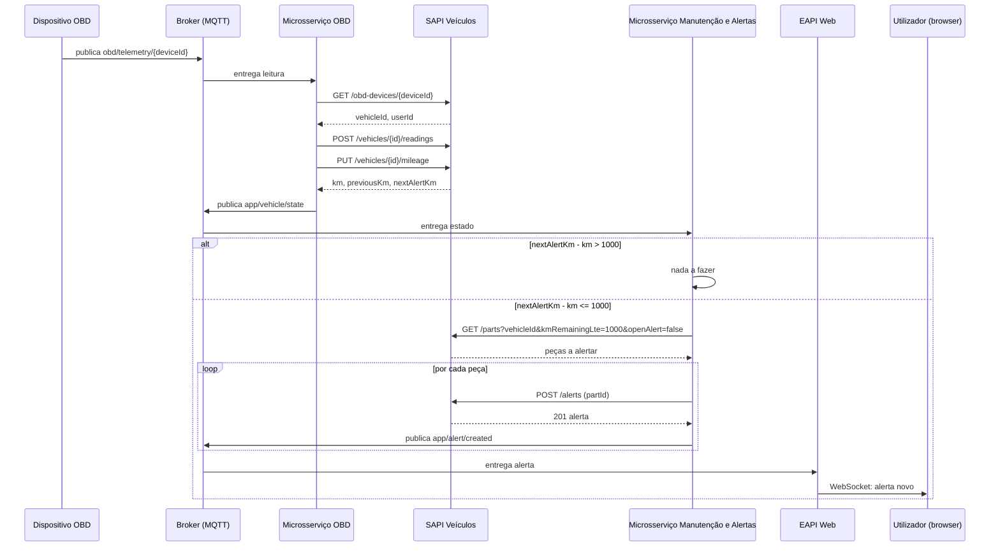

# SSD3 — Alertas e prazos (v2)

CarMotoCare — SSD3: Alertas e prazos (v2, 22 nov. 2026)
Substitui o texto do diapositivo 8 da apresentação da fase 2.

A) Criação de alerta por km
Em cada leitura, o Microsserviço OBD atualiza a km na SAPI Veículos (PUT /mileage), que responde com nextAlertKm:
o menor km previsto de serviço entre as peças sem alerta aberto. O microsserviço publica km, previousKm e
nextAlertKm em app/vehicle/state. O Microsserviço de Manutenção e Alertas compara nextAlertKm com a km atual sem
consultar a SAPI. Só quando faltam 1000 km ou menos pede à SAPI as peças nessa situação
(GET /parts?vehicleId&kmRemainingLte=1000&openAlert=false), cria um alerta por peça (POST /alerts) e publica
app/alert/created; a EAPI Web notifica o utilizador por WebSocket. Como essas peças passam a ter alerta aberto,
o nextAlertKm seguinte avança para a próxima peça e não há alertas repetidos.

A2) Criação de alerta por data (tarefa diária)
Uma vez por dia, o microsserviço consulta os prazos pendentes (GET /deadlines), as inspeções a vencer
(GET /inspections) e as peças com data prevista próxima (GET /parts?dueWithinDays), cria os alertas em falta e
publica app/alert/created. A mesma tarefa repete a verificação das peças por km, para os veículos parados cujo
intervalo foi alterado.

B) Consulta de alertas
O utilizador vê todos os alertas, vindos da SAPI Veículos através da EAPI Web (GET /alerts).

C) Conclusão de alerta
O utilizador conclui o alerta ao registar a manutenção que atualiza a peça (POST /maintenances), o pagamento de
IUC/seguro (POST /expenses) ou a inspeção (POST /inspections); a SAPI fecha o alerta na mesma transação.

Alternativas consideradas (para o relatório)
- GET às peças a cada estado: descartado, carga proporcional a veículos × leituras e dependência da SAPI.
- Cache no microsserviço (Redis ou base simples) invalidada por evento: funciona, mas obriga a manter em cache
  também os alertas abertos (fechados pela SAPI), a criar um tópico de invalidação publicado pela EAPI após 4
  operações e a tratar cache desatualizada. Escolheu-se o nextAlertKm por usar a chamada que já existe, não
  precisar de infraestrutura nova e nunca ficar desatualizado.

## Diagrama de sequência — parte A

